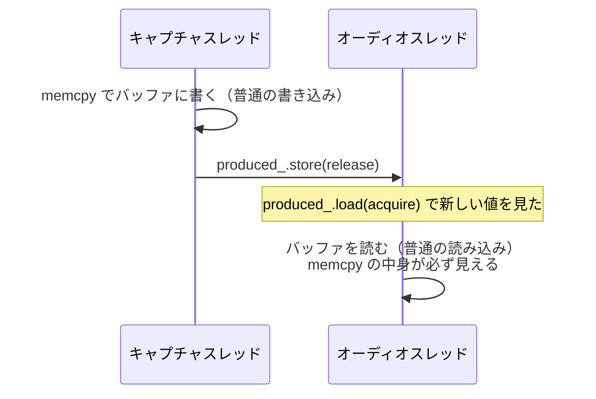

# std::atomic のまとめ

ray.sniff~ のキュー（[source/core/byte_ring.h](../source/core/byte_ring.h)、[packet_queue.h](../source/core/packet_queue.h)）を読むために必要な、`std::atomic` と関連する機能のまとめ。設計の判断そのものは [design.md](design.md) の §4 ③ にある。

---

## 1. なぜ必要か

2 つのスレッドが同じ変数を使い、少なくとも一方が書き込む場合、普通の変数のままだと **データ競合（data race）** になる。C++ ではデータ競合は**未定義動作**で、次のようなことが実際に起きる。

- **書きかけの値を読む**：8 バイトの値を、半分だけ新しい状態で読んでしまう
- **コンパイラが順序を入れ替える**：「データを書いてから位置を進める」と書いても、最適化で位置を先に書くことがある。別のスレッドから見られていることを、コンパイラは知らない
- **CPU が順序を入れ替える**：コンパイラが順序を守っても、CPU が実行時に読み書きの順序を入れ替えることがある。arm64（Apple Silicon）はこの入れ替えが多く、x86_64（Intel）は少ない。**Intel で動いていたコードが Apple Silicon で壊れる**原因になりやすい

`std::atomic<T>` は、この 3 つをまとめて扱うための型。

---

## 2. std::atomic と lock-free

```cpp
std::atomic<std::uint64_t> produced_{0};
```

- `std::atomic<T>` の読み書きは、**途中の状態を他のスレッドから見られない**ことが保証される
- ただし「ロックを使わない」ことまでは保証されない。`T` が大きい型だと、内部でロックを使う実装もあり得る。オーディオスレッドではロックを取れないので、ロックを使わないことを確かめておく

```cpp
static_assert(std::atomic<std::uint64_t>::is_always_lock_free);  // コンパイル時に確認
```

- arm64 と x86_64 では、8 バイトまでの整数、`bool`、ポインタは lock-free になる
- **`volatile` は atomic の代わりにならない**。`volatile` はコンパイラの最適化を一部止めるだけで、書きかけの値を読むことも、CPU による入れ替えも防がない

---

## 3. 操作の種類

### load と store

```cpp
std::uint64_t v = produced_.load(std::memory_order_acquire);  // 読む
produced_.store(v + n, std::memory_order_release);             // 書く
```

1 回の読み出し、1 回の書き込みが、それぞれ途中で割り込まれずに行われる。**load と store の組み合わせは不可分ではない**。load と store の間に、他のスレッドが書き込むことはあり得る。

### read-modify-write（RMW）

読み出し・計算・書き込みを、**間に誰も割り込めない 1 つの操作**として行う。

| 操作 | 内容 | このプロジェクトでの使いどころ |
|---|---|---|
| `exchange(v)` | `v` を書き、それまでの値を返す | `clear_requested_`：要求を読むと同時に降ろす |
| `fetch_add(n)` | `n` を足し、それまでの値を返す | 使っていない（stats のカウンタは書き手が 1 つなので load + store にしている。下の段落を参照） |
| `compare_exchange_weak/strong(expected, v)` | 今の値が `expected` なら `v` に変える。違えば `expected` に今の値が入る | 使っていない（書き手が複数ある値を、ロックなしで更新するときに使う） |

**load と store に分けると壊れる例**（`clear_requested_` の場合）：

```cpp
if (clear_requested_.load()) {      // ① true を読んだ
                                     // ② ここでメインスレッドがもう一度 clear → true
    clear_requested_.store(false);  // ③ ② の要求を false で消してしまう
}
```

`exchange(false)` にすれば、② は `exchange` の前か後のどちらかにしかならないので、要求が消えることはない。

**書き手が 1 つだけの変数なら、load と store に分けてよい。** `produced_` はキャプチャスレッドだけ、`consumed_` はオーディオスレッドだけが書くので、間に別の書き込みが入る心配がない。stats のカウンタ（`QueueStats` と `PcapDropCounter`）もキャプチャスレッドだけが書くので、`fetch_add` ではなく load + store で足している。これを型 `SingleWriterCounter`（[source/core/single_writer_counter.h](../source/core/single_writer_counter.h)）にまとめ、`add()` と `load()` しか使えないようにしている。型の名前で「書き手は 1 つ」という前提が分かり、`std::atomic` を直接触ってうっかり別の操作をすることもない。名前に `atomic` を入れていないのは、不可分な加算だと誤解されないようにするため。

---

## 4. memory order

atomic な操作には、**その前後にある普通のメモリ操作を、どこまで入れ替えてよいか**を指定する。指定しないと最も厳しい `seq_cst` になる。

| 指定 | 意味 | 使う場面 |
|---|---|---|
| `relaxed` | その変数自体の読み書きが不可分なだけ。前後の操作の順序は何も保証しない | 自分しか書かない変数を読むとき、独立したカウンタ |
| `release`（store に付ける） | **この store より前の読み書きは、store より後に回されない** | 「ここまで書き終えた」と相手に知らせるとき |
| `acquire`（load に付ける） | **この load より後の読み書きは、load より前に回されない** | 相手の知らせを受け取り、その後でデータを読むとき |
| `acq_rel`（RMW に付ける） | acquire と release の両方 | RMW で受け取りと知らせを同時に行うとき |
| `seq_cst`（既定） | acq_rel に加えて、全スレッドから見て atomic 操作の順序が 1 つに決まる | 迷ったとき。少し遅い |

### release と acquire の組

**release で書いた値を、別のスレッドが acquire で読んだとき、release より前の書き込みがすべて見える**ようになる。これが、atomic でないデータ（リングバッファの中身）を受け渡すための仕組み。



- `relaxed` で store すると、オーディオスレッドが新しい `produced_` を見た時点で、`memcpy` の中身がまだ見えていないことがある。`produced_` 自体は atomic でも、中身が壊れる
- 逆向きも同じ。オーディオスレッドが読み終えてから `consumed_` を release で書き、キャプチャスレッドが acquire で読む。これで、読み終わる前に上書きされることがなくなる

### 読む順序に意味がある例：`unread_bytes()`

```cpp
const std::uint64_t consumed = consumed_.load(std::memory_order_acquire);
const std::uint64_t produced = produced_.load(std::memory_order_acquire);
return produced - consumed;
```

3 つ目のスレッド（メインスレッド）から呼ばれる。`produced_` を先に読むと、その後で読み手が `consumed_` を進めた場合に `consumed > produced` になり、符号なしの引き算が巨大な値になる。`consumed_` を先に読めば、後で読む `produced_` は必ずそれ以上になる（`consumed_` は `produced_` を追い越さないため）。

### CPU 命令との対応（参考）

| 操作 | arm64 | x86_64 |
|---|---|---|
| `load(relaxed)` | `ldr` | `mov` |
| `load(acquire)` | `ldar` / `ldapr` | `mov` |
| `store(release)` | `stlr` | `mov` |
| `exchange` | `swpal`（ARMv8.1 の LSE 命令） | `xchg` |
| `fetch_add` | `ldadd` 系 | `lock xadd` |

x86_64 はもともと順序の保証が強いので、acquire と release が普通の `mov` になる。**順序を間違えても Intel では動いてしまい、Apple Silicon で初めて壊れる**ことがあるのはこのため。

---

## 5. alignas とキャッシュライン

```cpp
alignas(kCacheLine) std::atomic<std::uint64_t> produced_{0};
alignas(kCacheLine) std::atomic<std::uint64_t> consumed_{0};
```

`alignas(N)` は、変数をメモリ上で `N` の倍数のアドレスに置くようにコンパイラに指示する。

### false sharing

CPU は、メモリを**キャッシュライン**という単位（Intel は 64 バイト、Apple Silicon は 128 バイト）でキャッシュに読み込む。別々の変数でも同じラインに入っていると、一方のスレッドが書くたびに、もう一方のスレッドのキャッシュが無効になる。結果は正しいままだが遅くなる。これを **false sharing** と呼ぶ。

`produced_`（キャプチャスレッドが書く）と `consumed_`（オーディオスレッドが書く）を `alignas(128)` で別々のラインに置き、これを避けている。`ByteRing` のメモリ配置は次のとおり。

| オフセット | 中身 | 書き込むスレッド |
|---|---|---|
| 0 | `memory_`, `buffer_`, `capacity_`, `index_mask_` | なし（作成後は変わらない） |
| 128 | `produced_` | キャプチャスレッド |
| 256 | `consumed_` | オーディオスレッド |
| 384 | `clear_requested_` | メインスレッド、オーディオスレッド |

- 128 にしているのは、Apple Silicon と Intel の大きい方に合わせるため
- C++17 の `std::hardware_destructive_interference_size` は、標準ライブラリによっては用意されていなかったり、ビルド対象によって値が変わって警告が出たりするので使っていない

### aligned new と最小 OS

`alignas(128)` のように普通より大きな境界を要求する型を `new` で作るには、C++17 のアラインメント指定付き `operator new` が必要になる。macOS では 10.14 以降の標準ライブラリで使えるので、最小 OS を 11.0 にしている（arm64 はもともと 11 以上が必須）。

---

## 6. このプロジェクトでの使い方一覧

| 変数 | 書き手 | 操作と memory order | 理由 |
|---|---|---|---|
| `produced_` | キャプチャスレッドだけ | 書き手：`load(relaxed)` → `memcpy` → `store(release)`<br>読み手：`load(acquire)` | 自分しか書かない値は relaxed で読める。`memcpy` の中身を release / acquire で渡す |
| `consumed_` | オーディオスレッドだけ | 読み手：`load(relaxed)` → 読む → `store(release)`<br>書き手：`load(acquire)` | 読み終わるまで上書きされないことを release / acquire で保証する |
| `clear_requested_` | メインスレッド（立てる）、オーディオスレッド（降ろす） | `store(true, release)` / `exchange(false, acquire)` | 書き手が 2 つあるので、降ろす側は RMW にする。`produced_` を読む前に行う（design.md §4 ③） |
| `SingleWriterCounter`（`QueueStats` の 4 つのカウンタ、`PcapDropCounter::total_`） | キャプチャスレッドだけ | 書き手：`add()`（`load(relaxed)` → `store(relaxed)`）<br>メインスレッド：`load()`（`load(relaxed)`） | 書き手が 1 つなので RMW は要らない。数値を数えるだけで、他のデータを受け渡さないので relaxed で足りる。`written_packets` と `written_bytes` を読む瞬間が少しずれることは許容する。`PcapDropCounter` の基準値 `last_` はキャプチャスレッドしか使わないので atomic ではない（スレッドを作り直しても、`join` と `std::thread` の生成が前後関係を保証する）。`resetstats` 用の `baseline_`（`QueueStats` と `PcapDropCounter`）はメインスレッドしか使わないので、これも atomic ではない |
| `CaptureThread::state_` | メインスレッド（`running` / `stopped`）、キャプチャスレッド（`finished` / `failed`） | キャプチャスレッド：`error_` を書く → `store(release)`<br>メインスレッド：`load(acquire)` → `error_` を読む | `failed` を見た時点で、エラーの文字列が書き終わっていることを release / acquire で保証する（design.md §5）。メインスレッドが書くのは、スレッドが動いていないとき（`start` の前と `join` の後）だけなので、2 つの書き手が同時に書くことはない |
| `CaptureThread::stop_requested_` | メインスレッドだけ | `store(true, relaxed)` / `load(relaxed)` | 止まってほしいという合図だけで、データは受け渡さない。止まった後の状態は `join` が同期する |
| `Engine::bytes_per_sample`（`ray.sniff~.cpp`、`@bitdepth`） | メインスレッドだけ | メインスレッド：`store(relaxed)`<br>オーディオスレッド：ブロックの先頭で `load(relaxed)` | 1 つの値だけで、他のデータを受け渡さないので relaxed で足りる。変えた次のブロックから反映される。作業用のバッファがないので、値が変わっても確保し直しは起きない |

---

## 7. よくある間違い

- **データを受け渡す合図を relaxed で書く**：合図の値は正しく届くが、データが届いていないことがある
- **書き手が複数ある変数を load と store で更新する**：間に入った書き込みが消える。RMW を使うか、書き手を 1 つにする設計にする
- **`volatile` を atomic の代わりに使う**：2 章のとおり、何も保証しない
- **atomic を使わず「Intel で動いたから大丈夫」とする**：x86_64 は順序の保証が強く、間違いが表に出にくい。arm64 で壊れる
- **一部だけ atomic にして満足する**：atomic なのは変数 1 つずつ。2 つの変数をまとめて一貫した状態で読むことはできない（`unread_bytes()` のように、読む順序で整合を取る）

---

## 8. 確かめ方

- **ThreadSanitizer（TSan）**：データ競合と、memory order の不足による競合を実行時に検出する。lock-free キューを変えた後は必ず実行する（手順は [CLAUDE.md](../CLAUDE.md)）
- TSan は実際に起きた実行の範囲しか調べられない。テストでは、小さなリング（4096 バイト）で何度も回り込ませ、`clear` を頻繁に要求するスレッドも動かして、起こり得るタイミングを増やしている（[tests/test_byte_ring.cpp](../tests/test_byte_ring.cpp)）

---

## 参考

- [std::atomic](https://en.cppreference.com/w/cpp/atomic/atomic)（cppreference）
- [std::memory_order](https://en.cppreference.com/w/cpp/atomic/memory_order)（cppreference）
- [alignas](https://en.cppreference.com/w/cpp/language/alignas)（cppreference）
