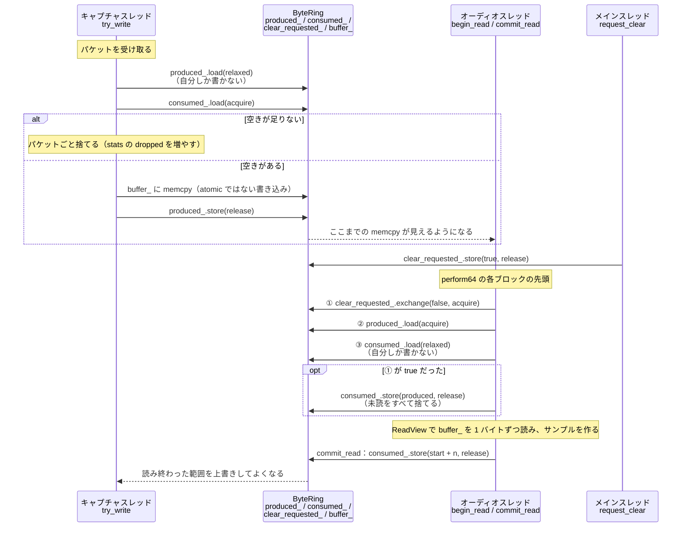

# ray.sniff~ 設計書

ray.sniff~ を現代化（Universal Binary 化と再設計）するときの仕様と決定事項をまとめる。
各項目の状態は次の 3 つで示す。

- **決定**：合意済み。理由とあわせて記録する
- **提案**：方向性は合意したが、細かい値などはまだ確認していない
- **未決定**：これから議論する

---

## 1. 目的とスコープ

| 項目 | 状態 |
|---|---|
| Universal Binary（arm64 + x86_64）にする | **決定**・実装済み |
| 管理者権限なしでキャプチャする方法を調べる | **決定**（6 章） |
| ソースコードを整理・再設計する | 進行中 |
| libpcap はシステム付属を使うか、最新版を自前でビルドするか | **決定**（5 章） |

コンセプトは変えない。パケットの生のバイト列をそのまま PCM 波形として出力する（パラメータへの割り当てはしない）。

### 暗号化された通信とローカルな通信（**決定**）
- 2026 年時点では Web の通信の大半が TLS で、ペイロードはホワイトノイズに近い音になる。**これは許容する。** それが現代の Web の特徴だから。ヘッダだけを音にするモードなどは作らない
- 一方で、**ローカルな通信には今も生のデータが流れているものがある**（OSC、mDNS、ARP、DHCP、SSDP、Art-Net / sACN など）。これらを表現に使う道は残っている。既存の `@device` と `@filter` で選べるので、追加の機能は必要ない
  - 例：`@filter udp port 7400`（OSC）、`@filter udp port 5353`（mDNS）、`@filter arp`
  - **同じマシン内の通信（127.0.0.1 宛ての OSC など）は `lo0` を流れる。** デバイスの自動選択は loopback を除外するので、`@device lo0` と明示的に指定する必要がある。Max 自身が `udpsend` で送った OSC を、同じパッチの ray.sniff~ で音にする、といった使い方もできる
  - Wi-Fi や、スイッチを経由した有線のネットワークでは、promiscuous モードでも他の機器どうしのユニキャスト通信はほとんど見えない。見えるのは自分の通信と、ブロードキャスト・マルチキャストの通信
  - **これまでの運用：ポートミラーリング機能のある L2 スイッチを使っていた。** 他の機器の通信を、ミラーポートにつないだ Mac に複製して送らせる方法。この運用を前提に、次の点を守る
    - **promiscuous モードは必ず ON にする**（ミラーされたフレームの宛先 MAC アドレスは、自分のものではないため）。現在の設計でも ON にしている
    - ミラーポートにつないだインターフェース（USB や Thunderbolt の Ethernet アダプタなど）には、IP アドレスが付いていないことが多い。**デバイスの自動選択は IPv4 アドレスがあるインターフェースを優先するので、Wi-Fi（`en0`）が選ばれてしまう可能性がある。** `@device` で明示的に指定するよう README とヘルプに書く
    - ミラーする対象のポートが多いと、流れてくる量が大きくなる。カーネルのバッファ（8 MB）やキューで取りこぼしていないかは、stats の `pcap dropped_packets` と `queue dropped_*` で確認できる
- README とヘルプには、これらの使い方の例を載せる

---

## 2. ビルドとリポジトリ構成（**決定**・実装済み）

- CMake と `max-sdk-base`（git submodule。新しい `cmake/` モジュール方式）を使う
- `CMAKE_OSX_ARCHITECTURES = arm64;x86_64`。**最小 OS は macOS 11.0 に明示的に設定する**（arm64 は 11 以上が必須。また max-sdk-base の既定値 10.11 では、lock-free キューの `alignas(128)` に必要な C++17 のアラインメント付き `new` が使えない）
- 出力先は `externals/ray.sniff~.mxo`。ad-hoc 署名する（max-sdk-base の既定動作）
- `AUTHOR_DOMAIN = com.leico`、バージョンは 0.2.0（仮の値）
- リポジトリ自体を Max パッケージの構成にする（`externals/`、`help/`、`source/`、`package-info.json`）
- 旧 Intel 版のバイナリは GitHub Releases の `legacy-intel` に移した
- **注意**：グローバルの gitignore に `*~` があると、`ray.sniff~` という名前のファイルやディレクトリまで無視される。リポジトリの `.gitignore` に `!ray.sniff~` を書いて打ち消している。旧版のバイナリが一部コミットされていなかったのも、これが原因だった

```sh
git submodule update --init
cmake -B build && cmake --build build
```

---

## 3. スレッド構成

| スレッド | 役割 |
|---|---|
| メイン | 引数・attribute・メッセージの処理、pcap の開閉、`size` の出力 |
| スケジューラ | `clock`（DSP の状態をポーリング）。重い処理はせず、`qelem` でメインスレッドに渡す |
| キャプチャ | `pcap_next_ex` → キューに書き込む（**唯一の書き手**） |
| オーディオ | キューから読む → 信号に変換する（**唯一の読み手**） |

原則：**オーディオスレッドはロックを取らず、メモリの確保も解放もしない。**

---

## 4. バッファ構成

```
NIC → ①カーネル BPF → ②libpcap の読み出しバッファ → キャプチャスレッド → ③自前のキュー → オーディオ
```

### ① と ②：pcap のバッファ（**決定**：8 MB）
- `pcap_set_buffer_size(8 MB)` を指定する
- 調べた事実（macOS 26 / XNU と Apple 版 libpcap のソースで確認）
  - `BIOCSBLEN` は `debug.bpf_bufsize_cap`（32 MB）を超える値を**エラーにせず黙って切り詰める**。元の 500 MB 指定は実際には 32 MB になっていた
  - BPF はダブルバッファなので、カーネル側でサイズの 2 倍を確保する。さらに libpcap が同じサイズを `malloc` する
  - 8 MB の場合、1 インスタンスあたり約 24 MB を使う（元の設定では約 96 MB）
  - 何も指定しないときの libpcap の既定値は 512 KB
- その他の設定：snaplen 65535、timeout 1 ms、promiscuous モード ON
- **snaplen 65535 の理由**：パケットを切らずに丸ごと取るため。IPv4 の全長の欄は 16 bit なので、IP パケットの最大は 65535 バイト
  - 通常の Ethernet は最大 1514 バイト、ジャンボフレームは約 9000 バイト、`lo0` の MTU は 16384
  - いちばん大きくなるのは**自分が送信する TCP のパケット**。macOS は TSO（TCP Segmentation Offload）で分割を NIC に任せ、BPF は分割の前に見るので、MTU を超えて最大 64 KB 近くのまま取り込まれる。snaplen を MTU に合わせると、これが途中で切られる
  - 今の libpcap / tcpdump の既定値は 262144 だが、65535 を超えるパケット（IPv6 のジャンボグラムなど）は Mac では通常見ないので、65535 で足りる
  - キューの最小サイズ `kQueueSizeMinKb`（128 KB）は、この最大の 1 パケットが必ず入るように決めている（キューより大きいパケットは、いつまでも書き込めず毎回捨てられるため）

### ③：自前のキュー（**決定**：lock-free SPSC）
- バイト単位のリングバッファ。容量は 2 のべき乗で、作るときに 1 回だけ確保する
- **記憶領域（決定）**：`mmap(MAP_ANON | MAP_PRIVATE)` で確保し、`mlock()` で物理メモリに固定する。小さな RAII クラスに包み、デストラクタで `munlock` と `munmap` を行う
  - `mlock` する理由：メモリが逼迫すると、macOS は使っていないページを圧縮したりスワップに追い出したりする。未読データのページが追い出されると、**オーディオスレッドが読んだときにページフォルトが起き**、音が途切れる（圧縮の展開で数十 µs、スワップからの読み込みで数 ms）
  - 固定すると、確保した時点で全ページが割り当てられる。その結果、**キャプチャスレッドでもオーディオスレッドでもページフォルトが起きなくなる**
  - `std::array`（大きさがコンパイル時に固定）と `std::vector`（大きさを変えられる機能が不要）は採用しない。`mlock` はページ単位で働くので、ページ境界に揃った `mmap` を使う（`malloc` で確保した領域だと、隣の確保領域のページまで固定してしまう恐れがある）
  - 確保と固定は**メインスレッド**で行う（オブジェクトを作るときと、止まっている間に `@queuesize` を変えたとき）。かかる時間は実測で、1 MB が 0.1 ms、256 MB が 23 ms、1 GB が 54 ms（Apple Silicon、通常のユーザー権限）
  - 固定したメモリは常に `queuesize` 分の実メモリを使う。1 つのシステムで巨大なキューを複数使うことはあまり想定しないので、許容する
  - **決定**：`mlock` に失敗したときは、**コンソールに警告を出して、固定せずに動作を続ける**（「固定できなかったので、メモリ逼迫時に音が途切れる可能性がある」）。固定できているかは stats の `queue locked` で確認できる
    - 理由：失敗するのは主に、メモリの少ない Mac がメモリ逼迫しているときに大きなキューを固定しようとした場合。大きなキューを使う場面で一番困るのは「パッチが動かないこと」なので、止めずに動かして状況が分かるようにする
    - 確認した事実：`RLIMIT_MEMLOCK` はシェルからでも Finder（launchd）からでも unlimited。`vm.global_user_wire_limit` は実メモリ 32 GB に対して約 27 GB
- **位置の管理（決定）**：`std::atomic<uint64_t>` を 2 つ使う（`static_assert(is_always_lock_free)`）。**`alignas(128)` で別々のキャッシュラインに置く**（false sharing を避けるため。128 の理由は [atomic.md](atomic.md) §5）
  - `produced_`：書き手がキューに入れたバイト数の累計。書き込むのは書き手だけ
  - `consumed_`：キューから取り除かれたバイト数の累計（読んだ分と、`clear` で捨てた分の両方を含む）。書き込むのは読み手だけ
  - **`% capacity_` で正規化せず、増やし続ける。** 添字にするときだけ `value & index_mask_`（`index_mask_ = capacity_ - 1`）を使う
    - 理由：未読のバイト数が常に `produced_ - consumed_` で求まり、0 なら空、`capacity_` なら満杯と区別できる（正規化すると、空と満杯がどちらも「位置が同じ」になり、1 バイト空けておくか変数を追加する必要がある）。64bit なので、毎秒 1 GB でも 0 に戻るまで約 580 年かかる。仮に 0 に戻っても、符号なし整数の引き算なので結果は正しい
  - 読み書きの順序と memory order は、下の「各スレッドの処理の順序」の図と、[atomic.md](atomic.md) §6 の一覧を参照
- **stats のカウンタとは分ける（決定）**：`produced_` / `consumed_` はリングバッファのクラスの内部に閉じ込める。stats のカウンタ（`written_packets_` / `written_bytes_` / `dropped_packets_` / `dropped_bytes_`）は別のクラス（例：`QueueStats`）に持たせる
  - 理由：`produced_` / `consumed_` は `resetstats` で 0 に戻してはいけない（未読のバイト数の計算が壊れる）。一方、`@queuesize` を変えるとリングバッファごと作り直されて 0 から始まる。stats は `resetstats` で 0 に戻し、`@queuesize` を変えても累計を続ける。値の意味も、リセットされる条件も違う
- オーディオスレッドは、リングバッファから 1 バイトずつ直接読んでサンプルを組み立てる。**作業用のバッファ（scratch）は使わない**
- **満杯のとき**：新しく届いたパケットを**パケットごと捨てる**（一部だけを書くことはしない）
- **キュー自体は古いデータを自動で捨てない。** いつ捨てるかは Max 側（パッチ）が `clear` で決める
  - 理由：リアルタイム性を優先するか、溜めて聞かせるかは表現上の判断なので、仕組み（キュー）と方針（パッチ）を分ける
- **`clear` の実装**：メインスレッドは `std::atomic<bool> clear_requested_` を立てるだけにする。オーディオスレッドが各ブロックの先頭でそれを確認し、`consumed_ = produced_` にする
  - `consumed_` を書き込むのは読み手だけ、という SPSC の原則を守るため
  - フラグは `exchange(false)` で読むと同時に降ろす（`load` と `store` に分けてはいけない理由は [atomic.md](atomic.md) §3）
  - **`exchange` は `produced_` を読む前に行う。** 逆にすると、`produced_` を読んでから `exchange` までの間に書かれたデータが `clear` の後も残る
  - DSP が止まっている間に送られた `clear` は、DSP を再開した最初のブロックで反映される

#### なぜロックなしで安全なのか：持ち主の境界

`std::atomic`、memory order、`alignas` などの基礎は [atomic.md](atomic.md) にまとめている。

`produced_` と `consumed_` は、バッファのどのバイトをどのスレッドが触ってよいかの**境界**を表す。データの各バイトは、同時に読み書きされても安全になったのではなく、**そもそも 2 つのスレッドから同時に触られない**。

下の図は、横軸の全体がリングバッファ（`capacity_ = 16` の配列）を表す。`produced_` と `consumed_` の位置は、配列の添字（累計 `& index_mask_`）で示す。

例 1：`consumed_ = 21`、`produced_ = 30`（添字は 5 と 14）。空きが末尾から先頭に回り込む

```mermaid
gantt
    title capacity_ = 16（consumed_ = 21, produced_ = 30）
    dateFormat x
    axisFormat %L
    todayMarker off

    section consumed
    position = 5 : milestone, 5, 5

    section byte_ring
    未読 9 バイト : active, 5, 14
    空き : 14, 16
    空き（先頭に回り込む） : 0, 5

    section produced
    position = 14 : milestone, 14, 14
```



例 2：`consumed_ = 26`、`produced_ = 35`（添字は 10 と 3）。未読が末尾から先頭に回り込む

```mermaid
gantt
    title capacity_ = 16（consumed_ = 26, produced_ = 35）
    dateFormat x
    axisFormat %L
    todayMarker off

    section consumed
    position = 10 : milestone, 10, 10

    section byte_ring
    未読 : active, 10, 16
    未読（先頭に回り込む） : active, 0, 3
    空き 7 バイト : 3, 10

    section produced
    position = 3 : milestone, 3, 3
```



- 未読 `[consumed_, produced_)` は**読み手だけ**が触る。書き手はこの範囲には書かない
- 空き `[produced_, consumed_ + capacity_)` は**書き手だけ**が触る。読み手はこの範囲を読まない
- 未読と空きを合わせると、常にちょうど `capacity_` バイトになる
- 書き手が `memcpy` して `produced_` を進めると、書き終えた範囲が未読に移る。読み手が `consumed_` を進めると（`commit_read` と `clear`）、その範囲が空きに戻る。**境界を動かすことは、バイトの持ち主を相手に渡すこと**を意味する
- **添字が重なるとき**：`consumed_` と `produced_` の添字が同じになるのは、空のとき（未読 0 バイト）と満杯のとき（空き 0 バイト）の 2 通りある。添字だけ、つまり上のような図だけでは区別できない。累計の差 `produced_ - consumed_` が 0 なら空、`capacity_` なら満杯と区別する。累計を `% capacity_` で正規化しないのはこのため（上の「位置の管理」を参照）

この仕組みは、次の 3 つがそろって初めて成り立つ。

| 条件 | 欠けるとどうなるか |
|---|---|
| 境界（`produced_` / `consumed_`）が atomic | 境界の値を読んだときに、書きかけの値を見るおそれがある |
| acquire / release で読み書きする | `relaxed` だと、新しい `produced_` が見えても `memcpy` の中身がまだ見えないことがある（[atomic.md](atomic.md) §4） |
| 境界ごとに書き手が 1 つ（SPSC） | 書き手が 2 つあると、両方が同じ空き領域を自分のものだと思って書き込んでしまう。atomic でも防げない。`clear` を `consumed_` に直接書かず、要求のフラグにしたのはこのため |

#### 各スレッドの処理の順序

`try_write` / `begin_read` / `commit_read` / `request_clear` の中で、atomic な変数をどの順に読み書きするかを示す。点線の矢印は release と acquire の組（[atomic.md](atomic.md) §4）による受け渡しを表す。



- ① を ② より前に置く理由は、上の「`clear` の実装」を参照

---

## 5. libpcap（**決定**：macOS 付属のものを使う）

- `/usr/lib/libpcap.A.dylib`（Apple 版 1.10.1。x86_64 と arm64e を含む）
- 理由：Universal Binary 化の手間がなく、dylib の同梱や署名も不要。Apple 独自の拡張（PKTAP など）も使える
- 上流の最新版（1.10.7 / 1.11.0）で直った脆弱性は、主に rpcap、savefile、`bpf_filter()` に関するもの。ray.sniff~ は使っていないので、影響は小さいと判断した
- `pcap_lookupdev`（非推奨）は使わない。`pcap_findalldevs` で、IPv4 アドレスを持っていて接続中のインターフェースを優先して選ぶ（`pcap_lookupdev` は `utun0` などの VPN を選んでしまうため）

### キャプチャ部分の構成（**決定**）

`source/core/` に置き、Max に依存させない。

| ファイル | クラス・関数 | 役割 |
|---|---|---|
| `pcap_device` | `choose_default_device(const pcap_if_t*)` | 既定のデバイスを選ぶ。採点：IPv4 アドレスあり +8、接続中 +4、running +2、up +1。loopback は除く。一覧を引数で受け取る純粋な関数にして、偽の一覧でテストする |
| `pcap_source` | `PcapSource` | pcap ハンドルの RAII。`open_live(device)` と `open_offline(path)`。設定は snaplen 65535、timeout 1 ms、promiscuous ON、カーネルのバッファ 8 MB。`set_filter(expr)` は失敗しても元のフィルタのまま。開けなかったときは理由の種類（権限がない、など）とメッセージを返す |
| `drop_counter` | `PcapDropCounter` | `ps_drop` の 32 bit の桁あふれと、開き直しによるリセットを吸収し、オブジェクトを作ってからの 64 bit の累計にする。`resetstats` 用に基準値を持ち、`snapshot()` は基準値からの差を返す |
| `capture_thread` | `CaptureThread` | キャプチャスレッド。`pcap_next_ex` → `PacketQueue::push`。100 ms ごとに `pcap_stats` を呼んで `PcapDropCounter` に渡す。止めるときは停止要求のフラグと読み出しのタイムアウト（`pcap_breakloop` は使わない。下を参照） |
| `capture_session` | `CaptureSession` | メインスレッドから使う窓口。開く・閉じる・`@device` の変更（新しいデバイスを開けてから差し替える）・`@filter` の変更（止める → `set_filter` → 再開）。キューは Max オブジェクトが持ち、参照で受け取る（デバイスを変えてもキューの中身を残すため） |

- **ファイルの終わり**：`pcap_next_ex` は、ファイルの終わりで `PCAP_ERROR_BREAK`（-2）を返す。デバイスのときの `pcap_breakloop` と同じ値なので、ファイルから読んでいるときは「終了」として止まる（前の段階のコードは、ここで無限ループになっていた）
- **ファイルでは `pcap_stats` が使えない**（savefile ではエラーになる）。取りこぼしの累計は `PcapDropCounter` の単体テストで確かめる
- **パケットの読み出しは `pcap_next_ex`（決定）**：コールバック方式（`pcap_loop` / `pcap_dispatch`）は使わない
  - `pcap_loop` は読み出しのタイムアウトでは戻らないので、止めるには `pcap_breakloop` が要る（下の「スレッドの止め方」と合わない）
  - `pcap_dispatch` はタイムアウトで戻るが、停止要求を確かめられるのはバッファ 1 杯分を処理した後になる。`pcap_next_ex` ならパケット 1 つごとに確かめられる
  - 読む・結果で分かれる・キューに入れる・ときどき stats を取る、が 1 つのループに並ぶ。コールバックでは `static` の中継関数と `u_char* user` 経由の `this` が要り、処理が分かれる
  - 速さはほぼ同じ：`pcap_next_ex` も BPF から読んだバッファを 1 パケットずつ切り出すだけで、システムコールはバッファが空のときだけ。差は 1 パケットあたり関数呼び出し 1 回程度
- **スレッドの止め方（決定）**：`pcap_breakloop` は使わない。atomic な停止要求のフラグと、読み出しのタイムアウト（1 ms）で止める
  - 理由：`pcap_breakloop` を使うと、止めたときにフラグが残り、次に読んだときに `PCAP_ERROR_BREAK` が返ることがある。ファイルではこの値が「ファイルの終わり」と同じなので、区別できなくなる。使わなければ、`PCAP_ERROR_BREAK` は常に「ファイルの終わり」を意味する
  - 前提：macOS の BPF では、パケットが 1 つも届かなくても、タイムアウトで読み出しが戻る（XNU の `bpfread` はタイムアウト付きで待つ）。**実機で確認済み（2026-11-11）**：`[live]` のテスト「close returns quickly even when no packet arrives」を root で動かし、パケットが来ない `lo0` でも `close()` が 100 ms 以内に戻ることを 5 回続けて確かめた（8 章）
- **pcap の取りこぼしの累計（決定）**：キャプチャスレッドは、読み始めるときに `pcap_stats` の現在の値を基準にする（`PcapDropCounter::rebase`）。新しいハンドルや `pcap_setfilter` でカーネルのカウンタが 0 に戻るかどうかに関係なく、正しく累計できる。止まっている間（フィルタを変える数 ms）の取りこぼしは数えない
- **pcap の取りこぼしの `resetstats`（決定）**：`QueueStats` と同じく、メインスレッドが基準値（`baseline_`）に現在の累計を記録し、出すときは累計との差にする（`PcapDropCounter::reset` / `snapshot`）。累計そのものを 0 に戻さないので、書き手はキャプチャスレッドだけのまま
- **キャプチャスレッドで起きたエラーの伝え方（決定）**：キャプチャスレッドは、メッセージを文字列に書いてから、状態（動作中・終了・失敗）を atomic な変数に release で書き、止まる。メインスレッドは 100 ms ごとのポーリングで状態を acquire で読み、変わっていたらコンソールに出す。文字列は状態を書く前に 1 回だけ書くので、ロックは要らない。キャプチャスレッドから Max のコンソールへ直接は出力しない

---

## 6. キャプチャ権限（**決定**）

- macOS では、全パケットを取り込むのに**管理者の許可が必ず必要**。BPF、PKTAP、Network Extension のどれも同じ
- **external には権限の設定を同梱しない。** ユーザーに次のどちらかを選んでもらう
  1. `brew install --cask wireshark-chmodbpf`（おすすめ）
  2. Max を root 権限で起動する
- 理由：OS の権限設定まで external が抱えるのは、責務として割に合わない
- external 側でやることは、`pcap_activate` が `PCAP_ERROR_PERM_DENIED` を返したときに、上の 2 つの方法を Max コンソールに表示することだけ

---

## 7. オブジェクトのインターフェース

### 7.1 引数（**決定**：互換方針 a）
```
[ray.sniff~ <bitdepth> [device] [ip netmask] [filter ...] @attr value ...]
```
- `bitdepth` だけを位置で指定する引数として正式に扱う
- **`bitdepth` がない・正しくないとき（決定）**：エラーを表示し、**既定値 16 でオブジェクトを作る**。オブジェクトは常に作られる（7.4）ようにし、`@bitdepth` で後から直せるようにするため。16 は `@queuesize` の既定値の目安（16bit・48kHz で約 10 秒分）とも合う
- 旧形式の位置指定の引数（`device ip netmask filter...`）も**互換性のために読む**
  - `device` → `@device`、`filter...` → `@filter` として扱う
  - `ip` と `netmask` は**読み捨てる**。ip は使われておらず、netmask は `ip broadcast` のときだけ使うもので、しかもバイト順が正しくなかった
- attribute の指定は、位置で指定した引数より優先する

### 7.2 attribute
| attribute | 型 | 動作中の変更 | 方法 / 失敗したとき | 状態 |
|---|---|---|---|---|
| `@bitdepth` | int（8/16/24/32） | **できる。すぐに反映** | オーディオスレッドがブロックの先頭で読む atomic な値（作業用のバッファは使わないので、確保し直しは起きない）。不正な値は拒否 | **決定** |
| `@device` | symbol | **できる** | キャプチャスレッドを止めて開き直す。失敗したら元のデバイスのまま。キューの中身は残す | **決定** |
| `@filter` | 複数の atom（連結して BPF の式にする） | **できる** | キャプチャスレッドを止めて `pcap_setfilter` を呼び、再開する。失敗したら元のフィルタのまま | **決定** |
| `@queuesize` | int | **DSP とキャプチャの両方が止まっているときだけ** | それ以外のときは警告を出して無視 | **決定**（条件） |

`@queuesize` の細かい仕様
- **決定**：**単位は KB**。**2 のべき乗に切り上げる**。**最大は 1 GB**（`1048576`）
- **決定**：2 のべき乗でない値が入力されたら、**attribute の値そのものを切り上げた値に書き換える**（インスペクタや `getqueuesize` でも切り上げ後の値が見える）
- **決定**：インスペクタと `attrui` には、2 のべき乗の値（128〜1048576 の 14 通り）をプルダウンメニューとして表示する（`CLASS_ATTR_ENUM`）。ENUM は見せ方を変えるだけで、値は制限しない。数値の入力欄だと、ドラッグしたときに途中の値ごとに確保し直しと `mlock`、コンソールへの表示が起きてしまうため。`CLASS_ATTR_ENUMINDEX` は使わない（値が KB ではなく番号になり、`@queuesize 1024` と書けなくなるため）。メニューはインスペクタでの入力補助で、オブジェクトの箱やメッセージでは任意の値を受け付けて切り上げる
- **決定**：**最小は 128 KB**（1 パケットが最大 64 KB のため）。**範囲外の値は最小値・最大値に丸める**
- **決定（仕様とする）**：DSP を OFF にした直後は、キャプチャが閉じるまで（ポーリングの間隔で最大 100 ms ほど）`@queuesize` の変更が警告とともに断られることがある。少し待って送り直せば通る。Max 9 で確認（2026-11-11）
- **決定**：**既定値は 1 MB**（16bit・48kHz で約 10 秒分）
- **決定**：オブジェクトの引数（`@queuesize`）でもメッセージでも指定できる（引数での指定は禁止しない）。2 のべき乗でない値や範囲外の値も受け付け、2 のべき乗に切り上げて範囲内に丸めたうえで、**丸めたことをコンソールに表示する**（例：`ray.sniff~: queuesize 1000 KB -> 1024 KB`）
- 実装上の注意：記憶領域は `mmap` と `mlock` で確保する（4 章の③）。確保に失敗したら、エラーを表示して元の大きさのままにする

`@filter` の細かい仕様
- **決定**：受け取った atom を空白でつないだ 1 つのシンボルとして持つ（`CLASS_ATTR_SYM`）。そのため、インスペクタや `getfilter` では `"tcp port 80"` のように引用符付きで表示される（空白を含むシンボルの、Max の普通の表記。Max 9 で確認、2026-11-11）。保存して読み込み直しても、そのまま送り返しても元に戻る
  - atom のリスト（`CLASS_ATTR_ATOM_VARSIZE`）で持てば引用符なしで表示できるが、採らない。`t_raysniff` に固定長の配列を持つことになり、フィルタの長さ（atom の数）に上限ができるため

### 7.3 メッセージ
| メッセージ | 動作 | 状態 |
|---|---|---|
| `int` | 正の数でキャプチャしたい、0 以下でしたくない、という**意思表示**（実際に開くかは 7.4 で決まる） | **決定** |
| `clear` | キューを空にする（4 章の方法で） | **決定** |
| `size` | **deprecated**（互換性のために残す）。キューにある未読のバイト数を `size <bytes>` として出す。今後は `stats` の `queue size` を使う | **決定** |
| `stats` | 統計を、右のアウトレットから項目ごとに分けて出す（7.5） | **決定** |
| `resetstats` | stats のカウンタをすべて 0 に戻す。`clear` ではリセットしない（キューを空にすることと統計は別のもの） | **決定** |

右のアウトレットは **dumpout 形式**（**決定**）。すべての出力の先頭に名前を付け、`[route size pcap queue]` で振り分けられるようにする。

### 7.4 pcap を開閉するタイミング（**決定**）
- オブジェクトは**常に作られる**。作るときには pcap を開かないので、権限がなくてもパッチは壊れない
- **pcap を開くのは「このオブジェクトの DSP が ON」かつ「`int` で 1 を受け取っている」とき**。それ以外のときは閉じる
  - DSP の状態は `sys_getdspobjdspstate()` で判断する（`poly~` の mute や `pcontrol` にも従う）
  - DSP が ON でも `0` のときは閉じる。開いたままだと、カーネルのバッファに古いパケットが溜まり続けるため
- **状態の検出**：`clock` で 100 ms ごとにポーリングする。状態が変わっていたら `qelem` でメインスレッドに渡し、そこで開閉する
  - DSP の ON/OFF を知らせる公式のコールバックはない。`dspchain_addmixerlistener` は文書化されておらず、登録を解除する API もないので使わない
  - `dsp64` が呼ばれたら次の確認を前倒しする、という組み合わせは任意
- エラーは、開こうとしたときに 1 回だけ表示する（ポーリングのたびに繰り返さない）
- **開けなかったとき（決定）**：エラーを 1 回表示し、**次のきっかけまで開き直さない**。きっかけは、`int` を送り直す（0 以下を経なくても、正の数を受け取ったら）、DSP を入れ直す、`@device` を変える、`@filter` を変える、のどれか
- **動いている途中でキャプチャスレッドが失敗したとき（決定）**：（USB の Ethernet アダプタを抜いた、など）エラーを 1 回表示して閉じる。開き直すきっかけは上と同じ
- この判断は Max に依存しない状態機械（`source/core/capture_gate.h`）にまとめ、単体テストで確かめる

### 7.5 stats（**決定**：キューと pcap の取りこぼしを出す）
| 項目 | 取得する場所 | 備考 |
|---|---|---|
| キューで取りこぼした数 | キャプチャスレッドが、満杯で捨てたときに atomic なカウンタを増やす | パケット数とバイト数のどちらも数えられる |
| pcap で取りこぼした数 | `pcap_stats()` の `ps_drop`（カーネルの BPF バッファが満杯で捨てられた数） | macOS の BPF では、`ps_ifdrop` は常に 0 なので出さない |
| （参考）受信した数 | `pcap_stats()` の `ps_recv` | 取りこぼしの割合を出すのに使える |

**出力の形式（決定）**：`stats` を受け取ったら、**値ごとに名前を付けたメッセージを 1 つずつ**右のアウトレットから出す。`[route pcap queue]` → `[route received_packets ...]` のように振り分けたり、`print` でそのまま読んだりしやすくするため。

**出力する項目（決定）**
```
pcap dropped_packets <n>     ps_drop：フィルタに一致したが、カーネルのバッファが満杯で捨てられた数
queue locked <0|1>           キューの記憶領域を mlock で固定できているか（4 章③）
queue size <bytes>           キューにある未読のバイト数（produced_ - consumed_）。累計ではなく現在の値なので resetstats の影響を受けない。処理待ちの clear は、まだ反映されていない値になる
queue written_packets <n>    キューに書き込んだパケット数
queue written_bytes <n>      キューに書き込んだバイト数
queue dropped_packets <n>    キューが満杯で捨てたパケット数
queue dropped_bytes <n>      キューが満杯で捨てたバイト数
```
- `pcap received_packets`（`ps_recv`）は**出さない**（決定）。XNU の `bpf.c` によると、`ps_recv`（`bd_rcount`）は**フィルタを通す前**に数える値で、フィルタを使っていると取り込んだ量とも取りこぼしの割合とも対応しないため。取り込んだ量は `queue written_*` で分かる
- pcap のカウンタはパケット数だけで、バイト数はない
- `ps_ifdrop` は macOS の BPF では常に 0 なので出さない

実装上の注意
- pcap ハンドルはスレッドセーフではない。`pcap_stats()` は**キャプチャスレッドが定期的に呼んで**、結果を atomic な変数に保存する。メインスレッドはそれを読むだけにする
- `pcap_stats()` のカウンタは、pcap を開き直すとリセットされる（デバイスの変更や DSP の OFF→ON のとき）。読み始めるときの値を基準にして差分を足し込み（`rebase`）、**オブジェクトを作ってからの累計**として出す
- カーネルのカウンタは 32bit（`u_int`）なので、上限に達すると 0 に戻る。前回の値との差分を 64bit の累計に足し込む形にして、0 に戻ったときも正しく数える
- キュー側のカウンタは 64bit の atomic（書き込むのはキャプチャスレッドだけ）。`resetstats` は、メインスレッドで基準値を記録して差分で出す（`QueueStats` と `PcapDropCounter` の両方。書き手を 1 つに保つため）

### 7.6 信号への変換（**決定**：元の挙動を維持）
- 1 サンプルごとに `bitdepth / 8` バイトを読み、リトルエンディアンで組み立てる（1 バイト目が最下位）
- `value == 0 ? 0 : -(value - peak) / peak`。`peak = 2^(bitdepth-1)`
- キューが空になったら、足りないサンプルは 0 にする
- **1 サンプル分に足りない端数のバイト（決定）**：読まずにキューに残し、次のブロックで使う（例：16 bit で残り 1 バイトなら、そのバイトは次のブロックの最初のサンプルになる）。バイト列の途中に 0 を挟まないので、届いたデータがそのまま音になる
- 変換は Max に依存しない関数（`source/core/sample_reader.h`）にまとめ、単体テストで確かめる。`ByteRing` から 1 バイトずつ直接読む（作業用のバッファは使わない。4 章③）

---

## 8. テスト方針

- **フレームワーク（決定）：Catch2 v3**。`FetchContent` で取り込み、`catch_discover_tests` で CTest に登録する。トップの CMake では `option(RAYSNIFF_BUILD_TESTS)` が ON のときだけ `tests/` を追加する
- **lock-free キューは ThreadSanitizer で確認する**（**決定**）。TSan と ASan は同時に使えないので、`RAYSNIFF_SANITIZER=thread / address` のようなビルドオプションで切り替える。書き手と読み手のスレッドを実際に同時に動かし、連番のデータが順番どおりに読めるかを大量に確認する
- **pcap は保存済みのキャプチャファイル（`pcap_open_offline`）でテストする**（**決定**）。権限なしで、毎回同じ結果で確認できる。そのために `PcapSource` を「デバイスからでもファイルからでも開ける」作りにする
  - **テスト用の `.pcap` はテストの中で作る（決定）**。`pcap_open_dead` と `pcap_dump` で一時ファイルに書き出す。リポジトリにバイナリを置かずに済み、どんなパケットが入っているかもテストのコードで分かる
- **実際のデバイスのテストは `[live]` タグで分ける（決定）**：`lo0` を開き、自分で 127.0.0.1 に送った UDP を捕まえる（[tests/test_live_capture.cpp](../tests/test_live_capture.cpp)）。`/dev/bpf*` を開けないときは SKIP する。`sudo ./build-test/tests/raysniff_tests "[live]"` で動かす
  - 確かめること：デバイス → フィルタ → `pcap_next_ex` → キューの経路、パケットが来ないデバイスでも `close()` が 100 ms 以内に戻ること（「スレッドの止め方」の前提）、デバイスでは `pcap_stats` が取れること
- **Max オブジェクト側**：ロジックはできるだけ Max に依存しない部分に寄せて Catch2 でテストする。Max 側は薄く保ち、ヘルプパッチで手作業で確認する
  - Max に依存しない部分に切り出すもの：キュー、キャプチャ、stats の集計、`@queuesize` の丸め処理、「DSP ON かつ `1`」で開閉を決める状態機械、ビット深度に応じたサンプルの変換
- **Max の API は C API のまま使う（決定）。Min-API には移植しない**
  - 理由：Min-API は開発が続いている（2026-10 にも大きな更新があった）が、リリースは 2021 年の v0.6.0 が最後で、API の変更も続いている。また、自前の `max-sdk-base` と古い CMake スクリプトを使うため、今のビルド構成を組み直す必要がある。最大の利点である「模擬環境での Max オブジェクトのテスト」は、ロジックを Max に依存しない部分に切り出すことで、ほぼ同じ効果が得られる

## 9. 未決定・TODO

- [x] ヘルプファイルの更新。`glitch $1` は現在のソースに実装がない。`clear` は再実装する
  - 作り直した（2026-11-12、英語、タブ 4 つ：基本の使い方・stats・引数と attribute・権限）。見た目は Max 上で手直し済み。今後は Max で編集したファイルを正とする
- [x] 実際にキャプチャして動作確認する（ChmodBPF を入れた環境か root 権限で）。Max 上での動作確認（2026-11-11、Max 9。10 章の手順 6）

## 10. 実装の現状

作業ブランチは `feature/universal`。

| 手順 | 内容 | 状態 |
|---|---|---|
| 1 | 設計書のコミット | 完了 |
| 2 | テストの土台（Catch2、`RAYSNIFF_BUILD_TESTS`、`RAYSNIFF_SANITIZER`） | 完了 |
| 3 | キュー（`source/core/`：`locked_memory`、`byte_ring`、`packet_queue`） | 完了。通常・TSan・ASan でテストが通る |
| 4 | キャプチャ部分（`source/core/` のみ。構成は 5 章。external はまだつながない） | 完了。通常・TSan・ASan でテストが通る。`lo0` での実機のキャプチャも `[live]` のテストで確認済み（2026-11-11、root で実行） |
| 5 | Max オブジェクト（状態機械、attribute、ポーリング、dumpout） | 完了。`capture_gate` と `sample_reader` は通常・TSan・ASan でテストが通る。external は Universal でビルドできる。Max の中での確認は手順 6 で行う |
| 6 | README の更新、Max 上での確認 | 完了。Max 9 での確認（2026-11-11）：読み込みと基本動作（音が出る、権限がないときの案内）、attribute とメッセージ、旧形式の引数は確認済み。metro から送ったメッセージと attribute は、Overdrive の ON・OFF のどちらでも動いた。Overdrive が ON のまま削除しても落ちない。`@filter` の表示（引用符付き）と、DSP を OFF にした直後の `@queuesize`（断られることがある）は仕様とした。ヘルプパッチを作り直し、README を今の仕様に合わせた（2026-11-12）。README の Concept に、暗号化された Web とローカルな通信についての段落を足した。テスト用のビルド（`RAYSNIFF_BUILD_TESTS=ON`）は external を作らないようにした（arm64 だけのビルドが Universal 版を上書きしていたため） |

手順 5 で、前の段階のコード（`packet_capture.{h,cpp}`：mutex と deque、古いものから自動で捨てる処理、作るときに pcap を開く処理、500 MB の指定）を消し、external に `raysniff_core` をリンクした。

**Max オブジェクトのスレッドの扱い（決定）**：メッセージ（`int`、`clear`、`stats`、`resetstats`、`size`）と attribute（`@device`、`@filter`、`@queuesize`）は、メインスレッド以外（metro からのスケジューラスレッドなど）で届いたら、メインスレッドに回す。`CaptureSession`、`CaptureGate`、stats の基準値、`Engine::ring`（`@queuesize` で差し替わるリングを指すポインタ）はメインスレッドしか触らない、という前提を保つため。
  - 回し方は `defer_low` ではなく **qelem**（決定）。呼び出し（名前と atom のコピー）を mutex で守った配列に積み、qelem で起こしたメインスレッドが届いた順に実行する。`defer_low` は、実行される前にオブジェクトが削除されると解放済みのオブジェクトで呼ばれるおそれがあるが、`qelem_free` はまだ実行されていない呼び出しを取り消す。mutex を取るのはスケジューラスレッドとメインスレッド（SIAI が ON のときはオーディオスレッドも。下の SIAI の項を参照）。`perform64` は取らない
  - 受け渡しはクラス **`DeferredCalls`**（決定）にまとめる。mutex と配列は private にし、`push()`（積む）と `take()`（中身を丸ごと取り出す）だけを公開する。ロックを取るのはこのクラスの中だけになる
  - **`t_raysniff` の C++ 部分の分け方（決定）**：`t_raysniff` は `object_alloc` で確保され、C++ のコンストラクタとデストラクタが呼ばれない。そのため、C++ のオブジェクトは `new` / `delete` で別に持つ。責務ごとに 2 つに分ける
    - `Engine`：キャプチャから音声まで（`queue`、`ring`、`bytes_per_sample`、`session`、`gate`）。Max の型を使わない
    - `DeferredCalls`：メインスレッドへの受け渡し。`t_atom` などの Max の型を使う
    - スケジューラの前回の観測値（`polled_dsp`、`polled_state`）は `bool` と enum だけなので、`t_raysniff` の `poll_clock` の隣に置き、`raysniff_new` で初期化する
  - Overdrive が ON のとき、スケジューラスレッドの `clock`（ポーリング）とメインスレッドの `raysniff_free` が同時に動いても問題ないか：SDK の例にならい、`free` で `clock_unset` と `object_free` をするだけにしている。**Max 9 で確認済み（2026-11-11）**：Overdrive を ON にして metro でメッセージと attribute を送り続けたまま、オブジェクトの削除とパッチを閉じる操作を繰り返しても落ちなかった
  - **`clear` と `size` もメインスレッドに回す（決定、2026-11-12 に変更）**：以前は「`clear` は atomic なフラグを立てるだけ、`size` は読むだけ」なので、どのスレッドからでもそのまま処理していた。しかし `@queuesize` はメインスレッドで古いリングを解放して差し替えるため、スケジューラスレッドの `clear` / `size` と重なると、解放済みのリングを触ってしまう（PR 前のレビューで指摘）。メインスレッドに回せば `@queuesize` と重ならない。`clear` の反映が qelem 1 回分遅れるだけで、仕様には影響しない
  - **Scheduler in Audio Interrupt（SIAI）が ON のとき（決定：許容する）**：metro などのメッセージがオーディオスレッドで届くので、`defer_call` がオーディオスレッドで `DeferredCalls::push()`（mutex と確保）を呼ぶ。起きるのはメッセージが届いたときだけで、`perform64` には影響しない。メインスレッドがロックを持つのは `take()` の `swap` の間だけなので、待つ時間は短い。確保もロックもしない受け渡し（固定長の lock-free キュー）にすると、`@filter` の長さに上限ができる（`@filter` の細かい仕様と同じ理由）ので採らない
`@bitdepth`（atomic に書くだけ）は、どのスレッドからでもそのまま処理する
